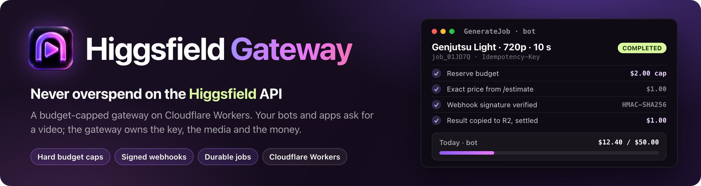
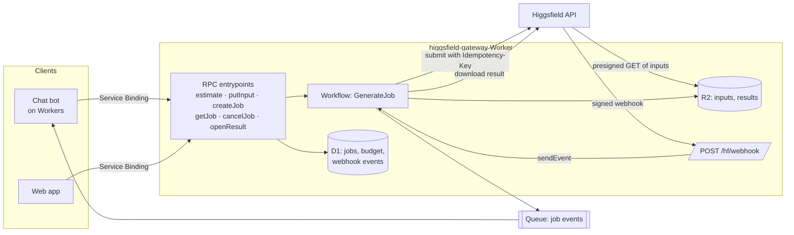

<div align="center">



**A secure, budget-capped gateway for the [Higgsfield API](https://docs.higgsfield.ai) on Cloudflare Workers.**
Run Genjutsu Light and Seedance 2.5 video jobs from your bots and web apps.
The gateway owns the API key, the media and the budget, and never spends past its caps.

[Quick start](#quick-start) · [How it works](#how-it-works) · [Architecture](docs/architecture.md) · [Security](docs/security.md) · [FAQ](#faq) · [Jutsu Studio](https://github.com/jutsuhq/jutsu-studio)

[](https://github.com/jutsuhq/higgsfield-gateway/actions/workflows/ci.yml)
[](LICENSE)
[](https://developers.cloudflare.com/workers/)
[](https://www.typescriptlang.org/)
[](#status)
[](#disclaimer)

</div>

---

## Status

**Alpha.** The gateway is implemented and tested against a mocked Higgsfield API. The observations marked **(live)** in [docs/higgsfield-api.md](docs/higgsfield-api.md) come from a private account calling the real API in October 2026; the gateway itself has not been run end to end against it.
Before the first deploy, confirm that the Genjutsu Light REST endpoint accepts requests (open question 1 in [docs/architecture.md](docs/architecture.md#open-questions)).

## Why Higgsfield Gateway

Calling the Higgsfield API straight from a bot or app is easy. Running it as a paid product is harder:

- generations take minutes, so the job has to survive restarts, retries and lost webhooks;
- one leaked key or bug can drain the prepaid balance, and Higgsfield has no API spending cap;
- input files need short-lived URLs, results must be stored and cleaned up, and webhooks must be verified;
- every client (chat bot, website, admin tool) ends up re-implementing the same logic.

Higgsfield Gateway puts all of that in one isolated Cloudflare Worker. Your apps only ask it to generate.

- **Hard budget limits.** Spending is reserved in D1 before submit: a per-job price ceiling, a per-client daily cap and a global cap. `createJob` checks the local list price; before submit the job is re-priced by `/estimate` and checked against both the client's `maxUsd` and the operator's per-job cap.
- **Durable jobs on Cloudflare Workflows.** Submit, wait for the webhook with `step.waitForEvent`, fall back to status polling, then deliver. Each job is one Workflow instance.
- **Idempotent by design.** Every submission carries an `Idempotency-Key`, so a retry never pays twice. Clients pass their own job id and get the same job back.
- **Signed webhook verification.** Higgsfield webhooks are checked with Standard Webhooks HMAC-SHA256, a 5-minute timestamp window and `webhook-id` deduplication.
- **Concurrency control.** The gateway tracks your Higgsfield concurrency tier itself, globally and per client, instead of hitting `429 account_queue_full`.
- **Private media on R2.** Inputs go to Higgsfield through presigned URLs that expire in hours. Lifecycle rules delete inputs and results, and job data is deleted on Higgsfield after delivery.
- **Isolated by default.** No public API: clients call it through Service Bindings (Workers RPC), each client has its own entrypoint and cannot impersonate another, and the only public route is the webhook. Isolation rests on per-Worker bindings and deploy rights: the entrypoint name is not a secret, so do not give one client's team deploy access to another client's Worker, or to the gateway.
- **Event-driven delivery.** Results reach clients through Cloudflare Queues, so a client that is down briefly loses nothing.
- **Cheap to run.** About $5 a month of Cloudflare usage at 10,000 videos a month, as estimated in [docs/costs.md](docs/costs.md).

## Supported models

| Model | Endpoint | Use case |
|---|---|---|
| Genjutsu Light, motion transfer | `higgsfield/genjutsu-light/motion-transfer/v1.0` | Put a person from a photo into a trending video (face/character swap) |
| Seedance 2.5, reference-to-video | `bytedance/seedance-2.5/reference-to-video` | Premium tier: rebuild a clip from images, video and audio references |

More Higgsfield models can be added through the per-client model allow-list.

## How it works



Job lifecycle: **reserve budget → submit → wait (webhook or poll) → copy result to R2 → settle actual cost → emit event → clean up.**
Failed, NSFW-flagged and canceled jobs are not charged by Higgsfield, so the reservation is released.

The full design, with the RPC contract, D1 schema and failure handling, is in [docs/architecture.md](docs/architecture.md).

## Quick start

You need a Cloudflare account on Workers Paid, a Higgsfield API key, and a custom domain for the webhook route.

**1. Install and test:**

```bash
npm install
npm test
```

**2. Create the resources** and put the D1 id into `wrangler.jsonc`:

```bash
npx wrangler d1 create hf_gateway
npx wrangler r2 bucket create hf-media
npx wrangler queues create hf-events-bot
npx wrangler queues create hf-events-web
```

**3. Configure.** Set `vars` in `wrangler.jsonc`:
- `WEBHOOK_BASE_URL`: the public https origin of the webhook route.
- `RESULT_HOSTS`: required, no default. Replace the placeholder with comma-separated hostnames results may be downloaded from, matched exactly, e.g. `cdn.higgsfield.ai`. `createJob` fails while the placeholder is still there.
- `MAX_RESULT_BYTES`: the largest result to store, in bytes (`104857600` is 100 MB).
- `R2_ACCOUNT_ID`, `R2_BUCKET` (`hf-media`), `HF_CONCURRENCY` (your account's limit) and `GLOBAL_DAILY_CAP_CENTS`.

Add lifecycle rules on `hf-media` that delete `in/` and `out/` after 1–2 days.

**4. Set the secrets:** `HF_KEY` (`<key id>:<key secret>`), `HF_WEBHOOK_SECRET` (`whsec_…`, revealed in the Higgsfield Console first), and `R2_ACCESS_KEY_ID` / `R2_SECRET_ACCESS_KEY` from an R2 token with read-only access to `hf-media`:

```bash
npx wrangler secret put HF_KEY
```

For local runs, copy [`.dev.vars.example`](.dev.vars.example) to `.dev.vars` and fill in the same four values.

**5. Give the webhook a route.** Uncomment `routes` in `wrangler.jsonc` and set the same host as `WEBHOOK_BASE_URL` (add the custom domain to the Cloudflare account first if it is not there yet). Without a route the webhook never arrives and every job waits for polling.

**6. Migrate, add a client and deploy:**

```bash
npm run db:migrate
npx wrangler d1 execute hf_gateway --remote --command "INSERT INTO clients VALUES ('bot', 5000, 300, '{\"genjutsu-light/motion-transfer\":[\"480p\",\"720p\"]}', 2)"
npm run deploy
```

**7. Bind the gateway** in the client Worker and consume its events queue:

```jsonc
"services": [{ "binding": "HF", "service": "higgsfield-gateway", "entrypoint": "BotEntrypoint" }],
"queues": { "consumers": [{ "queue": "hf-events-bot" }] }
```

Adding a client takes a `WorkerEntrypoint` subclass in [src/rpc.ts](src/rpc.ts), a queue bound as `EVENTS_<ID>`, and a `clients` row.

## Code

| File | Role |
|---|---|
| [src/rpc.ts](src/rpc.ts) | RPC entrypoints: `estimate`, `putInput`, `createJob`, `getJob`, `cancelJob`, `openResult` |
| [src/workflow.ts](src/workflow.ts) | `GenerateJob`: slot, request, exact price, submit, wait, deliver, settle, emit, clean up |
| [src/db.ts](src/db.ts) | Budget reservation, concurrency slots and settling in D1 |
| [src/higgsfield.ts](src/higgsfield.ts) | `fetch` client for the Higgsfield REST API and its error mapping |
| [src/models.ts](src/models.ts) | Per-model limits, list prices and request bodies |
| [src/webhook.ts](src/webhook.ts), [src/index.ts](src/index.ts) | Standard Webhooks verification and the webhook route |
| [src/media.ts](src/media.ts), [src/mp4.ts](src/mp4.ts) | Input checks, MP4 duration and size, presigned R2 URLs |
| [src/reconcile.ts](src/reconcile.ts) | Hourly cron for lost and timed-out jobs |

## Documentation

- [Architecture](docs/architecture.md): components, RPC contract, D1 schema, job lifecycle, failure handling
- [Higgsfield API notes](docs/higgsfield-api.md): auth, statuses, idempotency, webhook signatures, rate limits, pricing, each with a source link
- [Security model](docs/security.md): isolation, spending limits, webhook verification, data retention
- [Costs](docs/costs.md): per-video Higgsfield cost and Cloudflare cost at 1k and 10k videos a month

## FAQ

**How do I verify Higgsfield webhook signatures in Cloudflare Workers?**
Higgsfield signs deliveries with the Standard Webhooks scheme: HMAC-SHA256 over `{webhook-id}.{webhook-timestamp}.{body}`, keyed with your `whsec_` secret.
Deliveries are unsigned until the secret is first revealed in the Higgsfield Console. See [docs/higgsfield-api.md](docs/higgsfield-api.md#webhooks).

**Why Workflows and not Queues or Durable Objects?**
A generation is a long wait between two short actions. Workflows give durable `waitForEvent` and `sleep`, built-in step retries and persisted state, so you don't hand-write a state machine.
See [docs/architecture.md](docs/architecture.md#why-workflows).

**Can I cap how much the Higgsfield API spends?**
Higgsfield has no spending limit or balance endpoint as of 2026-10. The gateway enforces caps itself.
Also keep the Higgsfield balance prepaid without auto top-up: that balance is the only true hard cap.

**Does the official `@higgsfield/client` SDK run on Workers?**
It depends on `axios` and `form-data` and has not been tested on Workers. The gateway uses a small `fetch` client instead.

**How much does a 10-second Genjutsu Light video cost?**
Billable seconds are output plus input video seconds. A 10-second clip at 720p is 20 billable seconds, which is $2.00 at list price and $1.00 with the max discount (prices as of 2026-10-26).
Prices for every model are in the [Higgsfield price table](https://jutsustudio.com/higgsfield-pricing/).

## Related

- [Jutsu Studio](https://github.com/jutsuhq/jutsu-studio): the unofficial open-source Mac app for Higgsfield
- [Swapjutsu](https://github.com/jutsuhq/swapjutsu-seedance-character-swap): open-source Seedance 2.5 character swap for Mac
- [Video API prices](https://github.com/jutsuhq/video-api-prices): what one second of AI video costs at 30+ API providers, updated daily

## Contributing

Issues and design feedback are welcome. Read [CONTRIBUTING.md](CONTRIBUTING.md) for setup and checks, and report vulnerabilities privately as described in [SECURITY.md](SECURITY.md).

## Disclaimer

Higgsfield Gateway is an **unofficial, community-built tool**. It is not affiliated with, endorsed by, or connected to Higgsfield AI or Cloudflare in any way. Higgsfield, Genjutsu, Seedance and other model names are trademarks of their respective owners.
Higgsfield prices and limits change, so check the [official docs](https://docs.higgsfield.ai) before relying on the numbers here.

## License

[MIT](LICENSE) © jutsuhq
